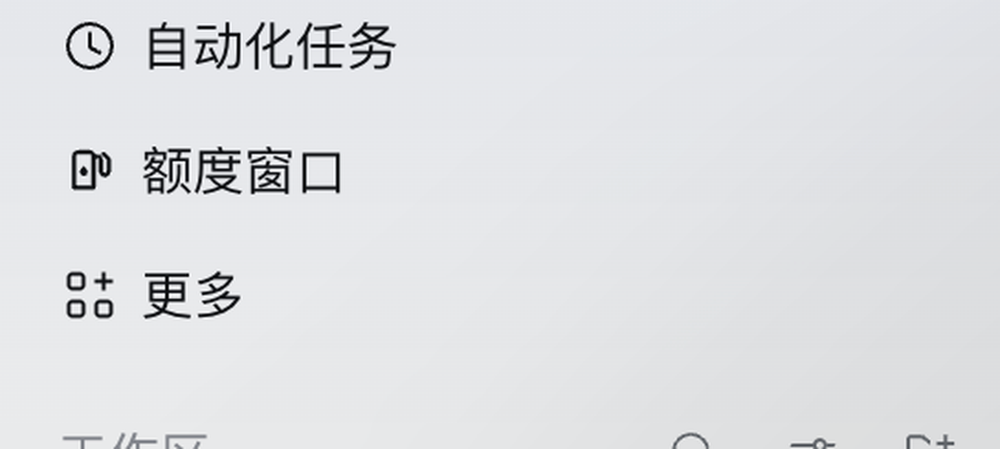
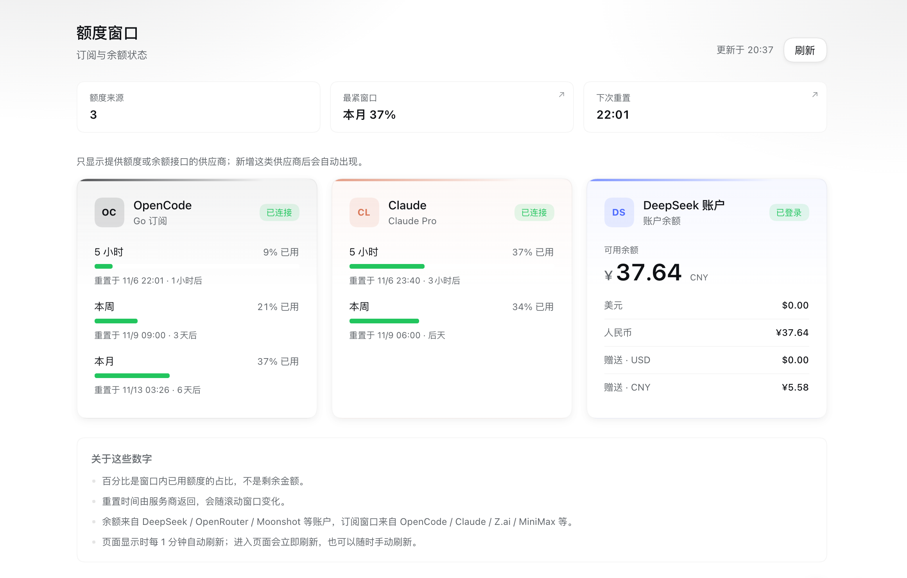

# Quota windows

A Harness plugin that puts one **额度窗口 / Quota windows** entry in the left
sidebar and one page behind it, showing the subscription and balance status of
every **added** provider whose usage or balance API this plugin supports.





## Install

Clone this repository, then add it to your DSH profile as a linked dependency and
select the `quota-windows` bundle:

```json
"@local/quota-windows": "link:/absolute/path/to/dsh-quota-windows"
```

The bundle name is `@local/quota-windows`; after the next load the sidebar entry
appears. Or install with the CLI:

```bash
dsh plugin --profile desktop add github:LXD-8/dsh-quota-windows
```

## Which providers appear

Discovery is dynamic. The Host reads the live LLM routes
(`llm.listProviders()`) and matches them against an adapter registry; a provider
added in Settings whose family has an adapter appears automatically, with no
plugin change. Providers without a public usage or balance API are not matched
and stay out of the page.

| Family | Route ids | Data |
| --- | --- | --- |
| OpenCode Go | `opencode-go`, `opencode-go*` | 5 小时 / 本周 / 本月 usage windows |
| Claude | `anthropic` (or the Claude Code credential on its own) | 5 小时 / 本周, Opus/Sonnet weekly, extra usage |
| DeepSeek | `deepseek`, `deepseek-official`, `deepseek-account` (or the signed-in account on its own) | recharge + bonus wallets |
| OpenRouter | `openrouter` | credit balance (total minus usage) |
| Moonshot / Kimi | `moonshotai`, `moonshotai-cn` | available + voucher balance |
| Z.ai / GLM | `zai`, `zai-coding-cn` | Coding Plan quota windows (5h / weekly / other durations) |
| MiniMax | `minimax`, `minimax-cn` | Token Plan session usage |

Each subscription card lists one row per window with its used percentage, a
severity-colored bar, and its reset time. Each balance card shows the available
amount and its wallets.
The overview's tightest-window and next-reset tiles are buttons: clicking one
scrolls to the matching source card and briefly highlights it.

Credentials are resolved per provider from the settings profile's `apiKeyEnv`
(falling back to the conventional `<ROUTE>_API_KEY` reference) through
`ctx.credentials`; Claude reads the Claude CLI token and DeepSeek uses the
account service, so neither needs a DSH route to be live.

## How it works

- `index.js` is the Host half: it matches live routes against `ADAPTERS`, reads
  each match, caches successes for 60 seconds (errors for 15), and serves
  `GET /quota-windows/api/snapshot` (add `?refresh=1` to bypass the cache).
- `client.js` is the Web half: it registers the `sidebar.panellist` entry and
  the `main` panel, re-reads the snapshot whenever the page is entered, polls
  every minute afterwards, and renders one grid of equally sized cards
  (three columns when the card count is a multiple of three, two otherwise). A page-level error boundary keeps a render crash from
  blanking the panel and reports it to `GET /quota-windows/api/client-error`.

## Brand colors

Each source card uses its brand accent. The provider directory exposes ids,
names, and base URLs only — no colors — so accents are a hand-maintained table
(`BRAND_ACCENTS` in `client.js`); ids outside the table fall back to a stable
hash color, so a newly supported provider still gets a distinct accent without a
code change.

## Configuration

Optional row config, validated by the Loader schema (`@deepseek-ai/schemastery`;
runtime coercion applies if it is unavailable), for example in the profile patch:

```yaml
- id: quota-windows
  config:
    cacheSeconds: 60
    opencodeBaseUrl: https://opencode.ai/zen/go/v1
    opencodeCredentialRef: OPENCODE_GO1_API_KEY
    claudeCredentialsPath: ~/.claude/.credentials.json
    # Hosts allowed in addition to loopback/IP/same-origin, for a reverse proxy.
    allowedHosts:
      - quota.example.com
```

## Notes

- The Claude token is read, never refreshed; when it expires the card asks you
  to sign in to Claude Code again.
- OpenCode Zen credit balance is not exposed by the API-key API, so only the Go
  subscription windows are shown.
- A provider family with no public usage/balance endpoint (for example OpenAI,
  Google, or a local model server) is intentionally not shown. Adding its
  adapter is the only step needed if such an endpoint appears later.
- All lookups are read-only.
- Provider failures are localized for HTTP status, timeout, and empty responses;
  provider-specific text remains as the detail after the localized prefix.
- `node --test tests/*.test.mjs` covers the pure parsers and the OpenRouter,
  Moonshot, Z.ai, and MiniMax adapters against stubbed HTTP responses.

## License

MIT
